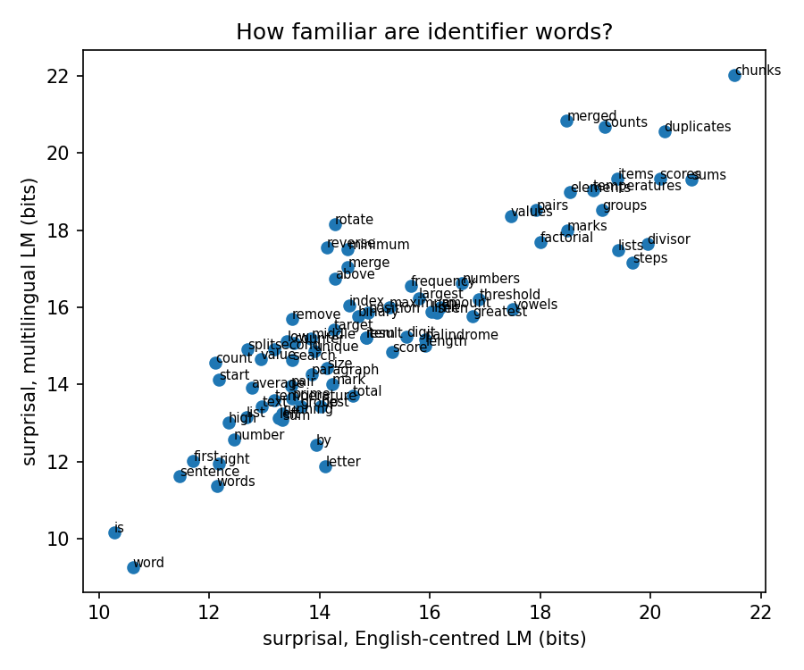
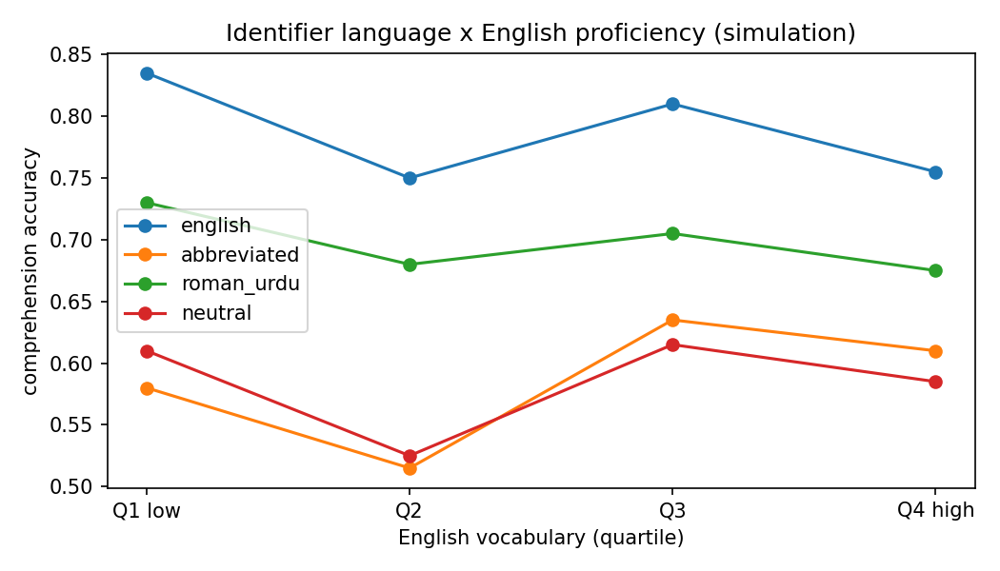
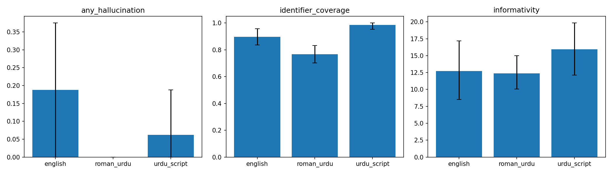
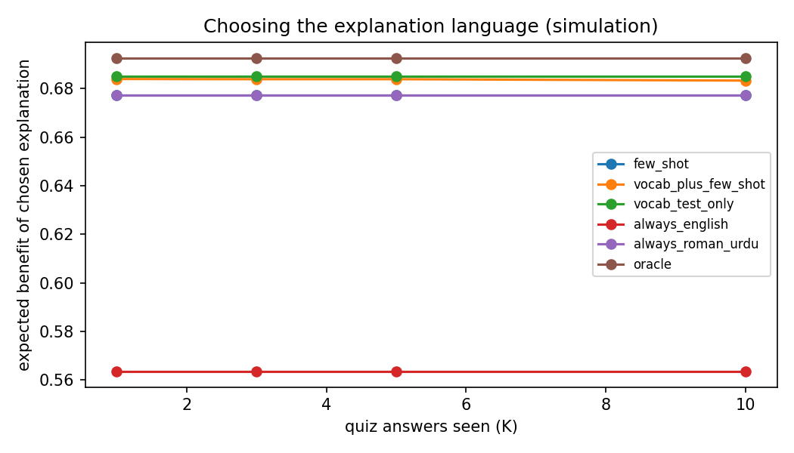

## Beyond-English-Identifiers-Modelling-the-Second-Language-Cost-of-Program-Comprehension
Almost all code is written with English names: `count_above`, `threshold`, `temperatures`. For a native speaker these names explain themselves. For a student in Karachi who thinks in Roman Urdu, every name is also a vocabulary item in a second language. This project asks how large that hidden cost is, which students pay it, and whether an AI assistant that explains code in the student's own language (English, Roman Urdu, or Urdu script) can reduce it.

The notebook is a pilot study. It combines cognitive modelling with language models, a controlled code-renaming experiment, multilingual LLM explanations with faithfulness checks, and a few-shot method for choosing the explanation language for each student.

> **Status:** pilot. Language-model measurements and generated explanations are real. Classroom responses are **simulated** with a known ground truth, so the analysis pipeline can be validated before collecting real data under ethics approval.

---

## Research questions

| | Question |
|---|---|
| **RQ1** | Do difficult English identifier names slow down comprehension, and does the effect depend on the student's English proficiency? |
| **RQ2** | Does a multilingual language model predict the difficulty that non-native readers experience better than an English-centred one? |
| **RQ3** | Are code explanations from a small LLM equally faithful in English, Roman Urdu and Urdu script, or does quality drop in the low-resource variety? |
| **RQ4** | Can a few quiz answers, combined with a short vocabulary test, tell us which explanation language will help a given student most? |

---

## Pipeline

```
20 Python functions
      │
      ├─► 1. Rename identifiers in 4 styles ──► run every variant, check output matches the original
      │        english · abbreviated · roman_urdu · neutral
      │
      ├─► 2. Word familiarity ──► surprisal of each identifier word under
      │        SmolLM2-360M (English-centred) and Qwen2.5-0.5B (multilingual)
      │
      ├─► 3. Classroom study (simulated) ──► 160 students × 20 items
      │        logistic model: naming style × English proficiency × item cost
      │
      ├─► 4. Explanations in 3 languages ──► Qwen2.5-1.5B-Instruct
      │        hallucination · identifier coverage · language check ·
      │        back-translation similarity · informativity
      │
      └─► 5. Few-shot language choice ──► Bayesian estimate of proficiency
               from K quiz answers (+ vocabulary test prior)
```

### Example: one function, four naming styles

```python
# english
def count_above(temperatures, threshold):
    counter = 0
    for temperature in temperatures:
        if temperature > threshold:
            counter += 1
    return counter

# abbreviated
def cnt_abv(tmpr2, thrs):
    cntr = 0
    for tmpr in tmpr2:
        if tmpr > thrs:
            cntr += 1
    return cntr

# roman_urdu
def ginti_upar(darja_e_hararat_list, hadd):
    ginne_wala = 0
    for darja_e_hararat in darja_e_hararat_list:
        if darja_e_hararat > hadd:
            ginne_wala += 1
    return ginne_wala
```

All 80 variants (20 functions × 4 styles) were executed and return exactly the same result as the original.

---

## Results (Colab, T4 GPU)

### 1. Identifier words are not equally familiar to both models

- 78 distinct English words appear in the identifiers.
- Surprisal under the two reader models correlates at **r = 0.87**. They mostly agree, but not completely, and the disagreements are what RQ2 needs real human data to resolve.
- The least familiar words in a neutral English context include plural and generic programming nouns: *chunks, sums, duplicates, scores, divisor, steps*.



### 2. Comprehension model recovers the simulated effects

Logistic regression on 3,200 simulated responses, with 95% bootstrap intervals over students:

| Term | Estimate | 95% CI | Simulated truth |
|---|---|---|---|
| Programming experience | 0.74 | [0.62, 0.84] | 0.8 |
| English names (meaning benefit) | 1.12 | [0.87, 1.38] | 0.9 |
| English name cost × low proficiency | **−0.94** | [−1.31, −0.57] | −0.9 |
| Abbreviated names | 0.32 | [−0.02, 0.72] | 0.2 |
| Abbreviation × low proficiency | −0.66 | [−1.37, 0.04] | −0.8 |
| Roman Urdu names | 0.55 | [0.37, 0.78] | 0.5 |

The key interaction (difficult English names hurt low-proficiency students more) is recovered with an interval that excludes zero, even though the vocabulary test is noisy. This shows the planned classroom study has enough power to detect an effect of this size with about 160 students.



### 3. The small LLM does not really write Roman Urdu

48 explanations (16 functions × 3 languages), each non-English one back-translated to English.

| Metric | English | Roman Urdu | Urdu script |
|---|---|---|---|
| Any hallucinated identifier | 0.19 | 0.00 | 0.06 |
| Identifier coverage | 0.90 | 0.77 | 0.98 |
| Informativity (nats) | 12.7 | 12.4 | 15.9 |
| Language check passed | 1.00 | **0.06** | 0.00 |
| Similarity to English (back-translation) | 1.00 | 0.46 | 0.54 |

The most important finding is the language check. When asked for Roman Urdu, Qwen2.5-1.5B-Instruct produced Roman Urdu in only **1 of 16** cases; it mostly answered in English. Roman Urdu is the variety that millions of Pakistani students actually use to talk about code, yet a small multilingual model cannot reliably produce it. The difference in informativity between Roman Urdu and English requests was not significant (−0.32 nats, paired permutation p = 0.85), which fits the fact that most "Roman Urdu" outputs were English anyway.

Note on the Urdu-script check: it requires more than half of all letters to be Urdu script. Explanations that keep many code names in Latin letters can fail this threshold even when written in Urdu, so this number should be checked by hand before drawing conclusions.



### 4. Choosing the explanation language

Share of students for whom each policy picks the best language (oracle match), and expected benefit:

| Policy | Oracle match | Expected benefit |
|---|---|---|
| Always English | | 0.564 |
| Always Roman Urdu | | 0.677 |
| Few-shot from quiz answers only | 0.78 | 0.677 |
| Vocabulary test only | | 0.685 |
| **Vocabulary test + few-shot answers** | **0.86** | 0.684 |
| Oracle | 1.00 | 0.693 |

Quiz answers alone barely improve with more shots (K = 1 to 10), because a wrong answer can come from weak programming or weak English, and the model cannot separate the two from a handful of items. A cheap vocabulary test used as a prior, updated with a few answers, gives the best match with the oracle (0.86). The lesson for the real study: **few-shot evidence works best on top of a short, direct proficiency measure.**



---

## Limitations

- **Simulated students.** Effects in sections 2 and 4 are generated from assumed parameters. They show that the pipeline can recover such effects, not that the effects exist. Real data is the next step.
- **Roman Urdu glossary.** Identifier translations were written by hand and are approximate; some are long (`darja_e_hararat_list`), which may itself add reading cost.
- **Automatic language and faithfulness checks** are heuristics. The Urdu-script threshold in particular is strict, and back-translation similarity uses character n-grams, not meaning.
- **Word familiarity** is surprisal in a neutral English sentence frame, not a measured frequency norm for Pakistani learners.
- **Small models.** All models are under 2B parameters so the notebook runs on a free Colab GPU. Larger models may write Roman Urdu much better.
- **One programming language** (Python) and short functions only.

---


If you use this code, please cite this repository.
